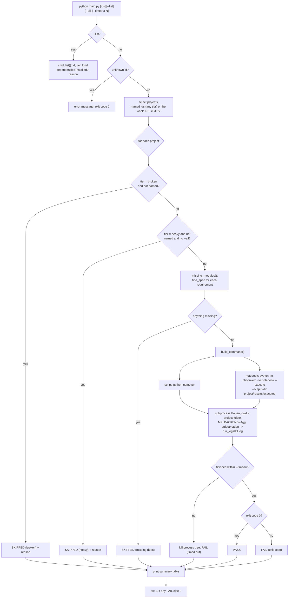

# Execution flow of `main.py`

Last verified against the code: 2026-11-06. The repository has no application server, database or services: the only
cross-file execution path is the runner that starts the five course projects.

`Entry point → argument parsing → registry → dependency check → subprocess (script | nbconvert) → log → summary table → exit code`

## Step table
| Step | Function (`main.py`) | What happens |
|------|----------------------|--------------|
| Registry | `REGISTRY` (list of `Item`) | One entry per project: id, title, kind, path, tier, required modules, reason for the tier |
| Select | `main()` | named ids run regardless of tier; otherwise quick projects run, heavy ones only with `--all`, broken ones never |
| Check | `missing_modules()` | `importlib.util.find_spec` per module (no import side effects). Notebooks also need `nbconvert` and `ipykernel` |
| Command | `build_command()` | script → `python <file>`; notebook → nbconvert with `--ExecutePreprocessor.timeout=<timeout>` (nbconvert's default is 30 s *per cell*) |
| Run | `run_item()` | `cwd` = project folder (data paths are relative); `MPLBACKEND=Agg` so plots never open windows; output captured in `run_logs/<id>.log`; on timeout the whole process tree is killed (`taskkill /T` on Windows) because the notebook kernel is a child process |
| Report | `print_table()` | id, project, status, seconds, note or log path |

## Data transformations and outputs
- Scripts read `<project>/data/...` and write to `<project>/results/` (partly tracked, see `.gitignore`).
- Notebooks are **never modified**: nbconvert writes an executed *copy* to `<project>/results/executed/`, so the stored outputs of the committed notebooks (from Colab) stay as they are.
- Logs: `run_logs/<id>.log` starts with the exact command and working directory.

## Error paths
| Situation | Result |
|---|---|
| Unknown id | message on stderr, exit 2 |
| Missing Python package | `SKIPPED (missing deps)` with the module names, not a failure |
| Script/notebook raises | `FAIL (exit code N)`; details in the log |
| Over the time limit | `FAIL (timed out after Ns)`, process tree killed |
| Broken project named explicitly (`04b`) | runs and FAILS with the real error (`NameError: df1`), which documents the defect |

## Projects (what each one does)
| Id | Entry | Tier | Reads | Writes |
|----|-------|------|-------|--------|
| 01 | `01-…/stats.py` | quick | `data/iex_mcp_apr_jul_2025.xlsx` | `results/daily_statistics.csv`, `results/mcp_distribution_plot.png` |
| 02 | `02-…/load_forecasting.ipynb` | broken | `data/EE467_EDA_Data_Group16_Load.csv` | executed copy |
| 03 | `03-…/pca_variance.py` | quick | `data/EE467_EDA_ICA2_PCA_Group3.csv` | `results/pca_plot_DS 3.png` |
| 04 | `04-…/co2_clustering_extension.py` | quick | `data/original/co2_room_{1,2,3}.csv` | `results/clustered_co2_features.csv` |
| 04b | `04-…/clustering_kmeans_dbscan.py` | broken | (none loaded) | — |
| 05 | `05-endsem/endsem_21d170001.ipynb` | quick | `data/EE467_EndSem_Data.csv` | executed copy |
